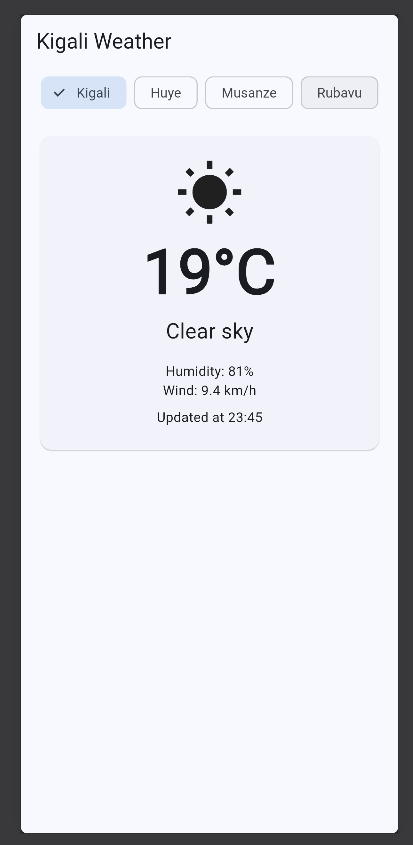
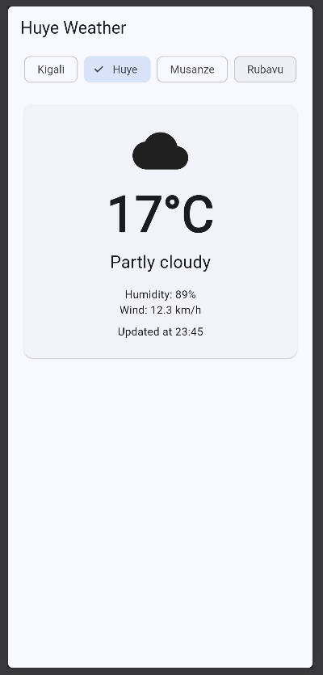
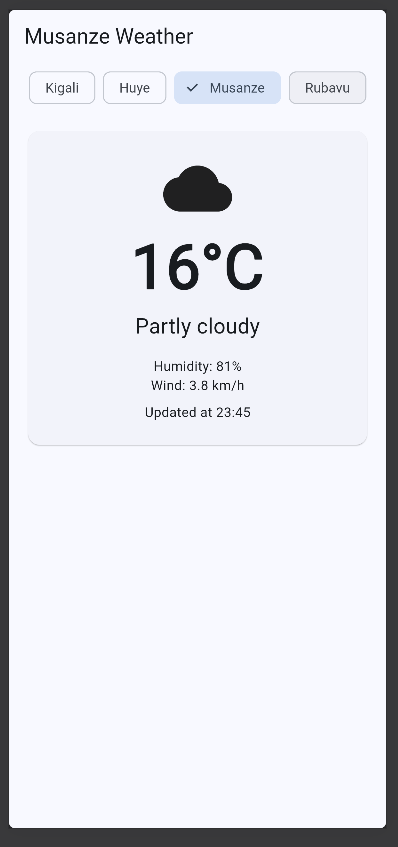
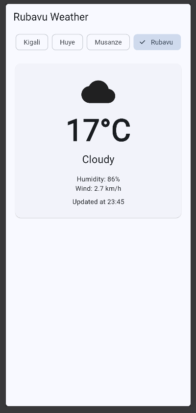
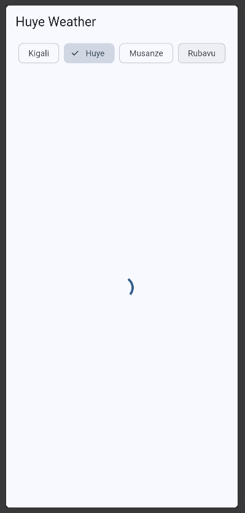
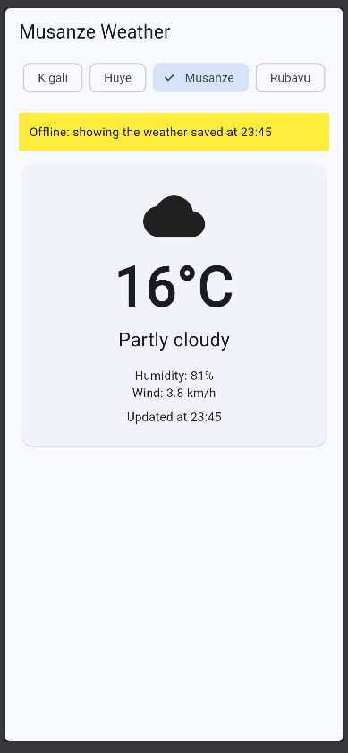

# Kigali Weather

A Flutter app that shows the live weather for four cities in Rwanda: Kigali, Huye, Musanze and Rubavu. The data comes from the free [Open-Meteo](https://open-meteo.com/) API, so no API key is needed.

Built for Mobile Programming, Week 3 · Session 5 (Data from the internet). Developed in GitHub Codespaces and run as a Flutter web app, so the screenshots are taken in the browser.

## Screenshots

<p align="center">
  
  
  
  
</p>
<p align="center">
  
  
</p>

1. **Four cities:** the live weather card for Kigali, Huye, Musanze and Rubavu. The title follows the chosen city.
2. **Loading:** the spinner while Huye loads.
3. **Offline, saved weather:** Musanze's last saved weather, with the yellow banner.

## Features

- **Weather card:** an icon for the sky, the temperature rounded, the sky in words, humidity, wind and the time of the reading.
- **Four cities:** chips at the top switch between Kigali, Huye, Musanze and Rubavu.
- **Loading, error and data states:** a spinner while loading, and a message with a **Retry** button when there is no internet.
- **Pull to refresh:** pull the card down to reload the weather.
- **Remembers your city:** the app opens on the last city you chose (`shared_preferences`).
- **Works offline:** each city's last weather is saved. With no internet it is shown under a yellow banner.

## Project structure

```
lib/
├── main.dart      # The app, the screen (loading, error and data states) and the weather card
└── weather.dart   # The Weather model, the cities and fetchWeather
```

## Packages

- [`http`](https://pub.dev/packages/http): calls the weather API
- [`shared_preferences`](https://pub.dev/packages/shared_preferences): saves the chosen city and the last weather

## Run it

```bash
flutter pub get
flutter run -d web-server --web-port 8080 --web-hostname 0.0.0.0
```

In Codespaces, open port 8080 from the **Ports** tab.

## Try offline mode

1. Open Musanze while you are online.
2. In Chrome DevTools, set **Network** to **Offline**, then choose Musanze again: its saved weather appears with the yellow banner.
3. Choose a city you have never opened: the error message and Retry appear.
4. Set Network back to online and tap **Retry**: the live weather loads.
